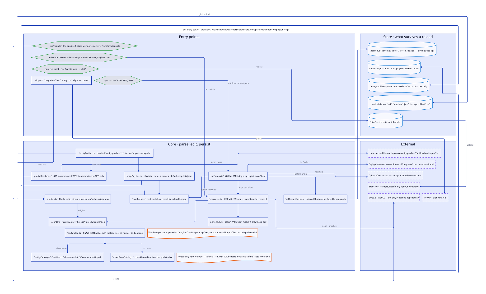

# sof-entity-editor — for humans

> A browser BSP viewer and entity editor for Soldier of Fortune maps: open a `.bsp`, drag entity markers around in 3D, edit their key/values and spawnflags, and save the result as a Quake-style entity string — entirely client-side, with no backend.

Read it left to right:

- **A `.bsp` is the map, and the editor is mostly a parser** — `bsp/parse.ts` reads the IBSP v46 header (22 lumps, not Quake II's 19), walks the lumps it needs, builds the world mesh for three.js and keeps model 0 around so `playerHull.ts` can draw the spawn box at the size the engine will actually use. Quake is Z-up and three.js is Y-up, so every coordinate crosses `coords.ts` in both directions; skipping that conversion is the classic way markers end up floating sideways.
- **Entities are text, so the file format is the API** — `entities.ts` parses and re-serialises the standard Quake entity string (`{ "classname" "monster" … }`), which means clipboard paste, a dropped `.txt` and an embedded BSP lump are all the same input. Edits round-trip through `formatOrigin` / `parseYawDegrees` so a hand-edited file still loads.
- **Spawnflags and field dropdowns come from QuArK, not from code** — `qrkCatalog.ts` parses the repo's `SOFEntities.qrk` (a QuArK project) for the toolbox tree, the bit meanings behind `spawnflags`, bounding boxes and per-field choice lists; `spawnflagsCatalog.ts` turns those bits into the checkbox panel. Adding an entity to the game means editing the `.qrk`, not the TypeScript.
- **Maps are fetched, never bundled** — `sof1maps.ts` lists `plowsof/sof1maps` through the GitHub contents API, downloads the chosen zip, picks the main `.bsp` out of it, and `sof1mapsCache.ts` keeps that zip in IndexedDB so reopening a map costs nothing. Only the small stuff ships in the bundle: playlists, the `.qrk`, and `entity-profiles/**/*.txt` via `import.meta.glob`.
- **Saving to disk is a dev-only illusion** — during `npm run dev` a tiny Vite middleware writes `entity-profiles/<profile>/<mapRel>.txt` (debounced 400 ms, path-sanitised against `..`); in a static build `import.meta.env.DEV` is false and the same data only leaves as a downloaded zip. That is why the README's "does it need a backend?" answer is *no, unless you want live profile files*.

Source: [`docs/system.d2`](docs/system.d2). Edit that, then run [`scripts/render-diagram.sh`](scripts/render-diagram.sh).
